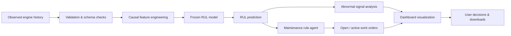

# 🛠️ Predictive Maintenance — AI-FBI

<p align="center">
  
  
  
  
  
</p>

<p align="center">
  <strong>NASA C-MAPSS engine-health monitoring for Tata Elxsi Teliport, Case 1</strong>
</p>

<p align="center">
  <em>AI-driven predictive maintenance for remaining useful life, anomaly detection, and maintenance planning.</em>
</p>

### 👥 Team

**Anumodit Shukla · Yogesh Singh · Anoop Kumar**

---

## 🌟 Overview

This project delivers a full-stack predictive maintenance system that combines:

- a trained RUL prediction pipeline,
- anomaly and signal diagnostics,
- a rule-based maintenance agent,
- and a deployed Streamlit + React dashboard for decision support.

The app estimates the remaining useful life (RUL) of engines, flags abnormal behavior, and generates maintenance work orders based on explicit operating rules. It runs packaged models for the NASA C-MAPSS FD001–FD004 family and keeps the logic transparent and auditable.

---

## ✨ Key Features

- 📈 Predicts engine health and remaining useful life using retained ML models
- 🚨 Detects abnormal behavior with robust statistical deviation signals
- 🧠 Builds work orders using a rule-based maintenance agent
- 📊 Visualizes RUL trends, maintenance history, and diagnostics in a dashboard
- 🔒 Verifies model and artifact integrity before app startup
- 🧪 Supports NASA TRAIN example data and direct trajectory uploads
- 🧾 Persists session state for agent logic without duplicate order creation
- 📦 Ships with bundled frontend assets and packaged model artifacts

---

## 🧭 System Architecture



---

## 🧪 What the app does

The Streamlit app lets users:

1. Select the appropriate NASA subset or upload a trajectory.
2. Choose an engine and the last observed cycle.
3. Run the model and maintenance agent.
4. Inspect the RUL timeline, anomaly diagnostics, and maintenance history.
5. Review generated work orders and retry identical prefixes without duplicates.
6. Download predictions, work orders, or the inference receipt.

> Use **Start new session** before revisiting an earlier cycle. Each session keeps its own temporary agent state.

---

## 🚀 Run locally

Use Python 3.12.

```bash
python -m pip install -r requirements.txt
python -B run.py
```

Open: http://127.0.0.1:8501

If the port is occupied:

```bash
python -B run.py --port 8502
```

You can also run the package integrity check separately:

```bash
python -B verify_package.py
```

---

## 📥 Input format

The app accepts:

- canonical-header CSV files, or
- whitespace-separated NASA trajectory text with 26 numeric columns:
  - engine ID
  - cycle
  - 3 operating settings
  - 21 sensor values

### Validation rules

- Complete available history per engine from cycle 1 onward
- Consecutive cycle ordering required
- No missing or non-finite values
- No duplicate keys, gaps, reverse histories, or incorrect schema
- Demo uploads limited to 5 MB and 5,000 observations
- One engine is processed at a time

Raw NASA data is not bundled in the repo. The example loader downloads the archive, validates the SHA-256 hash, and opens only the requested TRAIN member.

---

## 🧠 Model and maintenance logic

```text
Observed history → validation → causal features → frozen model
                                           ↓
                          RUL → rule agent → persisted work order
                                           ↓
                                  Streamlit dashboard
```

### RUL model

- Retained HistGradientBoosting models with a 115-cycle target cap
- Features are derived from the observed history up to the selected cycle

### Abnormal behavior

- Uses robust MAD deviation and a classifier for the RUL ≤ 30 proxy
- Informational only; it does not trigger maintenance orders in the retained policy

### Maintenance policy

- CRITICAL threshold: RUL ≤ 30 cycles
- WARNING threshold: RUL ≤ 60 cycles
- Two-cycle confirmation required
- 10-cycle hysteresis applied
- Emergency rule triggers at RUL ≤ 5 cycles
- Orders remain open until human intervention or reset conditions are satisfied

### Integrity safeguards

- Model hashes are checked before loading
- Identical-event retries reuse the same state and order
- No LLM is used; the logic is explicit, packaged, and deterministic

---

## 📊 Project structure

| File / folder | Purpose |
|---|---|
| `app.py` | Streamlit app and session orchestration |
| `ui.py` | Python bridge to the React dashboard |
| `frontend/` | React, JavaScript, CSS, and third-party licenses |
| `service.py` | Input validation, inference, and integration logic |
| `agent_v3.py` | Rule-based maintenance logic and persisted state |
| `model/` | Retained models, runtime code, and model manifest |
| `examples/provenance.json` | TRAIN example source and expected hashes |
| `run.py` | Integrity check and local launch |
| `verify_package.py` | Package verification script |
| `ARTIFACTS.json` | Artifact verification metadata |
| `requirements.txt` | Dependency list |
| `LICENSE` | MIT license |

> For a hosted Streamlit deployment, the app entry point is `app.py`. Upload the complete project including `ui.py` and `frontend/`; replacing only `app.py` is not sufficient.

---

## 🧩 Optional frontend development

To modify and rebuild the React frontend, use Node.js and pnpm from the `frontend/` folder:

```bash
pnpm install --frozen-lockfile
pnpm run build
```

Restart Streamlit after updating the frontend assets. Only frontend work requires these commands.

Keep `frontend/THIRD_PARTY_LICENSES.txt` with the bundled assets.

---

## ✅ Verification and limits

Local checks cover:

- all four retained models,
- causal-prefix parity,
- real agent integration,
- identical retry behavior,
- invalid input handling,
- and Streamlit interaction flow

The included examples are fitted TRAIN histories and were previously validated for use in the project.

Official TEST results remain benchmark-level historical validation; no new accuracy claims are made here.

### Current limitations

- Public hosting and clean cloud installation remain unverified
- Session storage is temporary and may reset on restart
- Broad ingestion-review integration and rollback workflows are planned
- Use downloaded outputs before restarting the app

---

## 🌐 Live deployment

The app is available here:

- https://tata-elxi-amyynlebpdqubokofwqlbm.streamlit.app/

---

## 📜 License

Project code is provided under the [MIT License](LICENSE).

NASA data is downloaded separately and is not bundled with this repository.

---

<p align="center">
  
  
</p>
